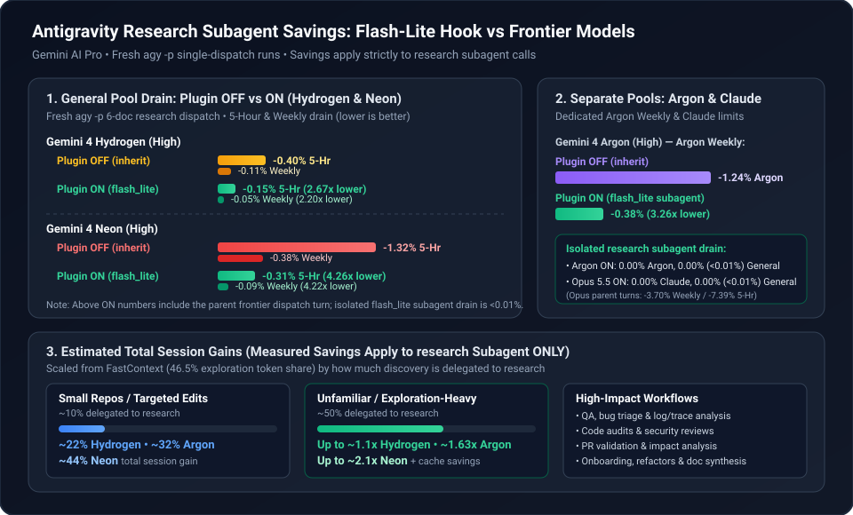

# Antigravity Lite Research

A zero-dependency Google Antigravity plugin providing two hardened subagents with pinned frontmatter models to reduce frontier-model quota drain:

- **`research`** (`model: flash_lite` → `gemini-3.5-flash-lite`): Read-only codebase explorer and web researcher with `< 0.01%` quota drain.
- **`worker`** (`model: flash` → `gemini-4-hydrogen-tiered-high`): Scoped mechanical worker for focused edits, lint/format fixes, single-file patches, and narrow test runs.

> [!NOTE]
> **Why there is no `PreToolUse` hook or Python dependency**: Current Antigravity builds honor each subagent's YAML frontmatter `model:` field directly—even when `invoke_subagent` passes `Model: "inherit"`—making a runtime `PreToolUse` rewrite hook unnecessary.

On fresh single-dispatch `agy -p` `research` benchmarks (Gemini AI Pro), pinning `research` to `flash_lite` bounds the `research` share at `< 0.01%` (`0.00%` measured on the General counters in the Claude-parent run, below `/usage` display resolution) — cutting benchmark-run drain by **2.67x** on **Gemini 4 Hydrogen (High)**, **4.26x** on **Gemini 4 Neon (High)**, and keeping **Claude Opus 5.5 (Medium)** subagent-attributable drain at **0.00%**.



---

## Subagents Architecture (`agents/`)

### 1. `agents/research.md` (Read-Only Explorer)
- **Model**: `model: flash_lite` (`gemini-3.5-flash-lite`).
- **Role**: Codebase exploration, file search, documentation lookup, and web research.
- **Tools**: Read-only allowlist (`send_message`, `read_file`, `list_dir`, `find_by_name`, `grep_search`, `read_url_content`, `search_web`) with `inheritMcp: false`. Write, shell, and MCP tools are excluded. *(Note: `view_file` is omitted because it resolves to the same tool name as `read_file` and causes an executor tool-name conflict.)*
- **Ceilings**: `max_turns: 15`, `timeout_mins: 5`.

### 2. `agents/worker.md` (Mechanical Worker)
- **Model**: `model: flash` (`gemini-4-hydrogen-tiered-high`).
- **Role**: Focused edits, lint/format fixes, single-file patches, log inspection, data conversion, and narrow test runs. Not for design decisions.
- **Tools**: Explicit allowlist (`send_message`, `read_file`, `edit_file`, `write_file`, `run_command`, `manage_task`, `search_web`) with `inheritMcp: false`. *(Legacy `enable_write_tools` / `enable_mcp_tools` flags are not honored by current loaders, which fall back to a read-only default set when `tools` is omitted.)*
- **Why `flash` instead of `flash_lite`**: `gemini-3.5-flash-lite` has higher error rates on exact-match whitespace diffs (`edit_file`) and recovery loops. `flash` (`gemini-4-hydrogen-tiered-high`) is 2x cheaper per token than Neon ($1.50/$7.50 vs. $3.00/$15.00), faster, and offloads 100% of worker drain from the Claude/GPT quota pool.
- **Guardrails**: Strict pre-edit inspection (`read_file` first to copy whitespace byte-for-byte), scoped edits, and an explicit **fail visibly** policy forbidding speculative workarounds.

---

## Empirical Benchmark Results

### 1. `research` Subagent (`flash_lite` vs. `inherit`)

Conducted on a **Gemini AI Pro** subscription using fresh, isolated `agy -p --model <id>` sessions on a single 6-document comparative synthesis task delegated to `research` (~33KB source text).

| Metric | `flash_lite` (Plugin ON) | Hydrogen High (`inherit`) | Neon High (`inherit`) |
| :--- | :--- | :--- | :--- |
| **Observed `PLANNER_RESPONSE.model`** | `gemini-3.5-flash-lite` | `gemini-4-hydrogen-high` | `gemini-4-neon-high` |
| **Benchmark-Run Quota Multiplier Savings** | **Baseline (`< 0.01%` `research` drain)** | **2.20x Weekly / 2.67x 5-Hr lower run drain** (`-0.05% / -0.15%` ON vs `-0.11% / -0.40%` OFF) | **4.22x Weekly / 4.26x 5-Hr lower run drain** (`-0.09% / -0.31%` ON vs `-0.38% / -1.32%` OFF) |

- **Claude pool preservation (`0.00%` subagent drain)**: On **Claude Opus 5.5 (Medium)** with Plugin ON, parent turns consumed `-3.70%` Weekly / `-7.39%` 5-Hr Claude quota while `research` ran on `gemini-3.5-flash-lite` with `0.00%` Claude movement and `0.00%` visible General counter movement (`< 0.01%`).

### 2. `worker` Subagent (`flash` vs. `inherit`)

Isolated `agy -p` runs on an identical 4-bug Python fix + 5-test `unittest` verification task (all runs passed 5/5 tests):

| Parent Model | `worker` Model | Duration | Claude 5-Hr Delta | Gemini 5-Hr Delta | Takeaway |
| :--- | :--- | :---: | :---: | :---: | :--- |
| **Claude Sonnet 5.5 (Low)** | `flash` (`gemini-4-hydrogen-tiered-high`) | 35.6s | **`-3.28%`** | `-1.04%` | **1.70x lower Claude drain** vs. `-5.58%` inheriting Sonnet |
| **Claude Opus 5.5 (Low)** | `flash` (`gemini-4-hydrogen-tiered-high`) | 42.0s | **`-6.59%`** | `-1.05%` | **1.79x lower Claude drain** vs. `-11.77%` inheriting Opus |
| **Gemini 4 Neon (High)** | `flash` (`gemini-4-hydrogen-high`) | **~58s** | `0.00%` | **`-1.43%`** | Lower drain & ~2x faster vs. `-1.63%`–`-3.29%` (71–119s) on Neon High |
| **Gemini 4 Neon (Medium)** | `flash` (`gemini-4-hydrogen-high`) | **~58s** | `0.00%` | **`-1.43%`** | ~31% lower drain & ~20% faster vs. `-2.07%` (72s) on Neon Medium |

---

## Installation & Setup

### Option 1: Antigravity Plugin (Recommended)
Install directly from GitHub via the Antigravity CLI:
```bash
agy plugin install https://github.com/carlosduplar/agy-lite-research
```

Or clone locally and install from the directory (via CLI or `/plugin install <directory>` inside `agy`):
```bash
git clone https://github.com/carlosduplar/agy-lite-research.git
agy plugin install ./agy-lite-research
```

Verify installation with `agy plugin list`.

### Option 2: Global Agent Configurations
Copy `agents/research.md` and `agents/worker.md` to `~/.gemini/config/agents/`.

### Option 3: Project Workspace Agents
Copy `agents/research.md` and `agents/worker.md` to `<project-root>/.agents/agents/`.

---

## Verifying Model Pinning End-to-End

1. Run an isolated dispatch:
   ```bash
   agy -p "Invoke the research subagent to read plugin.json and report its version number. Do not read plugin.json in the parent session."
   ```
2. Inspect the subagent log in `<appDataDir>/brain/<subagent-id>/.system_generated/logs/transcript.jsonl` to confirm:
   - `research` runs on `gemini-3.5-flash-lite`
   - `worker` runs on `gemini-4-hydrogen-tiered-high`

---

## Requirements

- Google Antigravity CLI (`agy`) or Antigravity IDE. *(No Python or external runtime dependencies.)*
